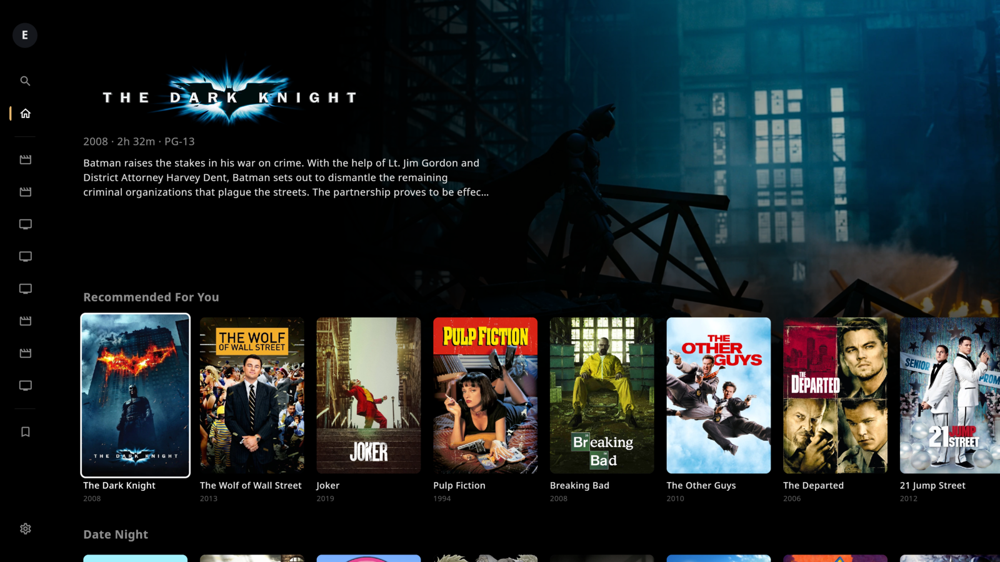

<p align="center">
  
</p>

<h1 align="center">Silage</h1>
<p align="center"><b>An unofficial Silo client for Linux</b> — a fullscreen, couch-friendly home-theater app for your <a href="https://siloserver.org">Silo</a> media server.</p>

<p align="center">
  
</p>

## Features

- **Direct play, full quality.** Silage plays your files as they are, with no server transcoding, using mpv (FFmpeg + libplacebo) with hardware decoding (VA-API, NVDEC, Vulkan).
- **HDR passthrough.** On a monitor with HDR enabled (KDE Plasma), video plays in a native Wayland surface with true HDR. Otherwise it's tone-mapped beautifully to SDR.
- **Great upscaling.** 1080p films on a 4K screen use mpv's high-quality profile (`ewa_lanczossharp`, debanding).
- **Choose your copy.** When a title is in several libraries (say *Movies* and *Movies (4K)*), pick which version to play: *4K · Dolby Vision · HEVC · TrueHD* or *1080p · H.264 · E-AC3*.
- **A player HUD like Silo's web player.** Seek bar with buffered range and intro/credits markers; audio, subtitle and speed menus; playback info; Skip Intro / Skip Credits.
- **Subtitles.** Built-in and downloaded subtitle tracks, with your profile's choice switched on automatically.
- **Plex-HTPC-style browsing.** A sidebar of your libraries, poster rows with a backdrop marquee, library grids, collections, movie and series pages with seasons and episodes, search, and a watchlist.
- **Resume anywhere.** Playback picks up where you left off; Back returns you to exactly where you were.
- **Made for a remote.** Everything works with arrows, Enter and Esc, as well as the mouse.

## Status

Early development. An AUR package is coming; for now, run it from source.

## Requirements

- Linux (X11, or Wayland via XWayland; HDR passthrough needs a native Wayland compositor such as KDE Plasma 6)
- **mpv / libmpv 0.37 or newer** (`pacman -S mpv`)
- **JDK 21** to build (`pacman -S jdk21-openjdk`)

## Run from source

```sh
git clone https://github.com/evman/silage.git
cd silage
./gradlew :app:run
```

On first launch, enter your Silo server's address, sign in, and pick your profile.

## Controls

| | Browsing | Playing |
|---|---|---|
| Arrows | Move around | ←/→ skip 10 s (HUD hidden); move between controls (HUD shown) |
| Enter | Open / select | Show the HUD / press the focused control |
| Space | — | Play / pause |
| I | — | Playback info |
| Esc / Backspace | Back | Close a menu, hide the HUD, then leave the player |

## Settings

Settings → Interface → **Sidebar** chooses which libraries appear in the sidebar and in what order. Settings → Video → **HDR** sets Auto / Always / Never.

## Logs

Playback logs and any unexpected errors are written to `~/.local/state/silage/`. Include them when reporting a problem.

## Credits and license

Silage is free software under the **GNU Affero General Public License v3.0 or later** (see [LICENSE](LICENSE)).
Its `shared` module is vendored from Silo's open-source Android client, [silo-android](https://github.com/Silo-Server), also AGPL-3.0.

Silage is **not affiliated with or endorsed by** the Silo project. *Silo* and the Silo logo are trademarks of Silo Media L.L.C.
